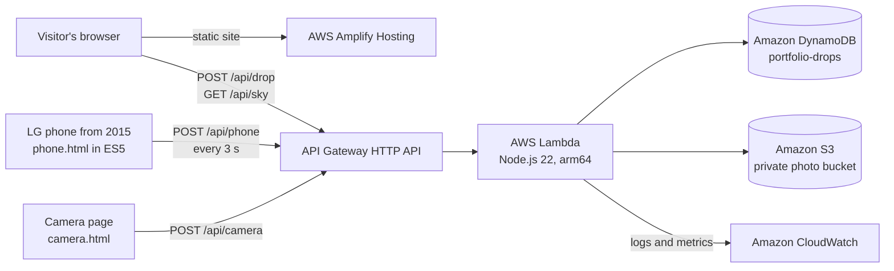

# Una gota: a sky you can touch

Portfolio of **José Ángel García Pérez**, Software Systems Engineering student specializing in cloud computing, cloud security and AWS infrastructure. Built for the AWS Student Builder Challenge.

The page is a painted sky rendered live by your device. It moves through a whole day as you scroll, from a bright afternoon to dawn. At night you can let go of a drop, and it lands on a real LG phone from 2015 in my room in Culiacán, Mexico.

**Live site:** https://main.dqzs24pr30jbn.amplifyapp.com

## The idea

Nobody has ever touched the cloud, and yet almost everything around us rests on it. A cloud is also made of millions of drops, so every visitor adds one. The phone is the part of this cloud you can actually hold.

## Architecture



| Service | What it does here |
| --- | --- |
| AWS Amplify Hosting | Serves the site and redeploys on every push to `main` |
| Amazon API Gateway | Public HTTPS endpoint with a throttle of 20 requests per second |
| AWS Lambda | The whole API in one function: drops, sky status and the phone's check-in |
| Amazon DynamoDB | Drop counter, the queue of pending drops, and the phone's latest status |
| Amazon S3 | A private bucket with the photo of each landed drop, deleted after 30 days |
| Amazon CloudWatch | Logs, custom metrics in `Portfolio/Sky`, a dashboard and an error alarm |
| AWS IAM | A deploy user limited to this project and a Lambda role limited to one table |

## Every drop puts me to practice

The visitor chooses what the drop asks of me: one push-up, one minute of guitar or one minute of studying AWS. The site shows a public scoreboard of what I owe and what I have done. A private page, authenticated with the same token, records practice that was really done, and the API refuses to mark more than visitors have asked for.

## How a drop travels

1. The visitor lets go of a drop. Lambda adds one to the counter and stores the drop in a pending queue.
2. The phone asks for pending drops every 3 seconds.
3. Each drop lands on the phone's screen as a ripple, with a vibration and a sound, one at a time.
4. The phone reports the delivery. Lambda stores the landing time, and the visitor's page shows it.
5. If the camera page is running, it photographs the phone's screen and the visitor sees the real photo of their drop.

Measured on the real phone with the page open: drops landed in 5.3 to 8.7 seconds. Six earlier drops waited in the queue for up to 64 minutes while the phone was off, and all of them landed.

If the phone is off, the drop stays in the queue and lands when the phone wakes up. Nothing is lost, and the page says the phone is asleep. It never invents a status.

## Decisions

- **The sky is a fragment shader, not an image or a video.** Each puff is a field of lit spheres. The page lowers its internal resolution, then its frame rate, to stay smooth on slower devices, and falls back to a CSS gradient without WebGL.
- **The phone's page is ES5 with XMLHttpRequest**, because it runs on a phone from 2015. It posts `text/plain` to avoid a CORS preflight.
- **The heartbeat writes every 15 seconds while polling happens every 3.** This keeps deliveries fast and writes cheap.
- **The queue lives in DynamoDB**, sorted by time, so a burst of visitors lands like rain instead of all at once.

## Security

- The Lambda role reaches one DynamoDB table, one S3 prefix and its own logs.
- The photo bucket blocks all public access, and photos are only served through the API.
- The phone and the camera authenticate with a token compared in constant time. The site lets anyone send a forged request and see the real rejection, and each attempt is counted.
- The API is throttled and every input is validated. Photos must be real JPEG files under 1.2 MB.

## Privacy

There are no accounts, no cookies and no analytics. A drop stores its number, its time and the visitor's time zone name, which the browser provides. IP addresses are not stored by the application. The camera only takes a photo when a drop lands, records no audio, and each photo is deleted after 30 days.

## Deploy

```bash
bash scripts/create-role.sh                          # once, with an identity that can write IAM and S3
AWS_PROFILE=portfolio bash scripts/deploy-api.sh     # table, function and API
AWS_PROFILE=portfolio bash scripts/dashboard.sh      # CloudWatch dashboard and alarm
```

Put the API URL in `web/config.js`, then connect this repository to AWS Amplify Hosting. `amplify.yml` publishes the `web/` folder.

The phone opens `/phone.html?t=<token>` once. The token is stored on the phone and in the Lambda environment, and never in this repository.

## License

Code under the MIT license.
